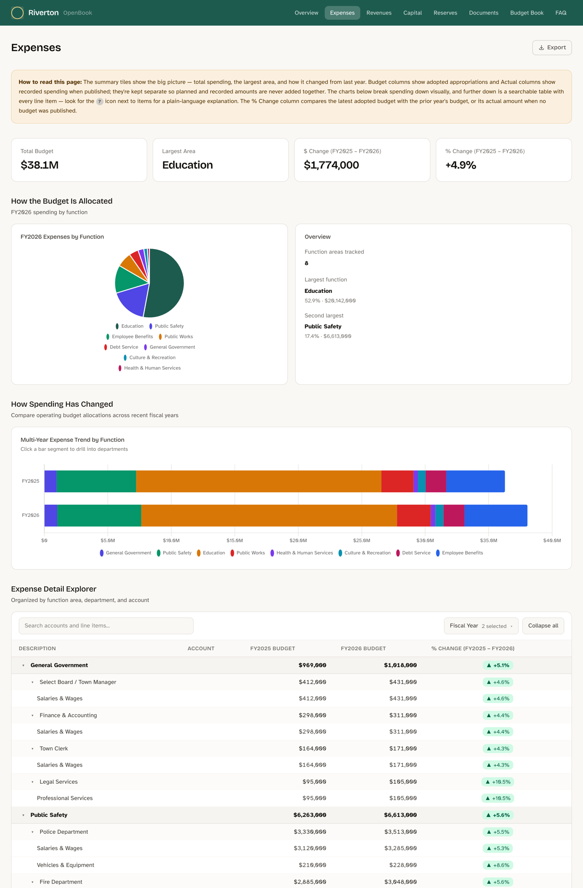
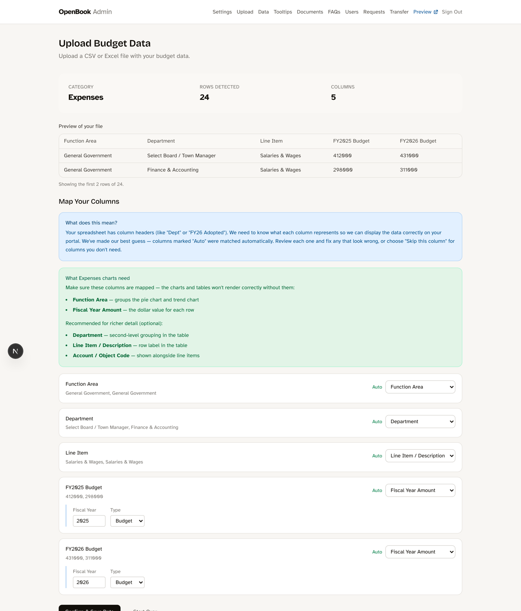

# OpenBook

[Live example](https://finance.suttonma.gov/openbook) · [Video tutorial](https://drive.google.com/file/d/1TQqr_wsY2va_tVfT1ZIegXhKJl2FYCHo/view?usp=sharing) · [Learn more](https://ash.harvard.edu/resources/open-book-open-source-budget-transparency-for-municipalities/) · [Report a bug](https://github.com/Allen-Lab-for-Democracy-Renovation/Open-Book/issues/new) · [Wiki](https://github.com/Allen-Lab-for-Democracy-Renovation/Open-Book/wiki)

**Guides:** [Town Managers](https://github.com/Allen-Lab-for-Democracy-Renovation/Open-Book/wiki/Guide-for-Town-Managers) · [IT Departments](https://github.com/Allen-Lab-for-Democracy-Renovation/Open-Book/wiki/Guide-for-IT-Departments) · [Finance Staff](https://github.com/Allen-Lab-for-Democracy-Renovation/Open-Book/wiki/Guide-for-Finance-Staff) · [Department Staff](https://github.com/Allen-Lab-for-Democracy-Renovation/Open-Book/wiki/Guide-for-Department-Staff) · [Local Testing](https://github.com/Allen-Lab-for-Democracy-Renovation/Open-Book/wiki/Local-Testing-Guide)

OpenBook is a free, open-source website that lets a town publish its budget online so residents can explore expenses, revenues, capital projects, and reserves in plain language. Finance staff upload the spreadsheets they already have, and OpenBook turns them into charts, searchable tables, and a printable budget book.

It was built for Massachusetts municipalities and reads UMAS exports, but it works with any CSV or Excel budget file.

[](https://drive.google.com/file/d/1TQqr_wsY2va_tVfT1ZIegXhKJl2FYCHo/view?usp=sharing)

*New to OpenBook? This 13-minute video walks through what OpenBook is, how it fits together, and how to set it up. Click the image to watch.*

**Contents**

- [Features](#features)
- [Requirements and cost](#requirements-and-cost)
- [Documentation](#documentation)
- [Local setup](#local-setup)
- [Portal setup](#portal-setup)
- [Deployment](#deployment)
- [Troubleshooting](#troubleshooting)
- [Development](#development)
- [Contributing and support](#contributing-and-support)
- [About](#about)
- [License](#license)

## Features

**For residents (public portal).** Each town gets its own branded portal at `/your-town`, with tabs for Overview, Expenses, Revenues, Capital, Reserves, Documents, Budget Book, and FAQ. Residents start with headline figures and can drill down to individual line items.

- Pie charts and multi-year trend charts, with budget and actual amounts shown side by side
- Searchable line-item tables that download as CSV
- A printable budget book
- Plain-language tooltips on budget items, supporting documents, and FAQs



**For finance staff (admin dashboard).** Admins upload CSV or Excel files and set the portal's name, color, logo, and contact email. They also write tooltips and FAQs and post documents. OpenBook matches spreadsheet columns to its own fields automatically and asks for confirmation before saving anything.



**For department staff (optional, internal).** Staff the admin invites can submit capital expenditure requests through a password-protected `/staff` portal, and the finance office reviews them in the admin dashboard. Requests are never shown to the public.

## Requirements and cost

OpenBook is a good fit if you want residents to be able to explore your budget online and you can export it to CSV or Excel.

- **Cost:** the software is free (MIT license). Hosting can also be free: Vercel's free tier plus a free Postgres database from Neon, Supabase, or Vercel Storage is enough for a town portal. Paid hosts such as Railway or Render cost about $5–$25/month.
- **What you need:** someone to do a one-time setup (a few hours for an IT contact), and someone to upload the budget data each year.
- **What it doesn't do:** OpenBook displays your contact email but doesn't receive or relay resident questions. It's a publishing tool, not an accounting system, so it only shows the data you upload.

## Documentation

Detailed, role-specific guides live on the [OpenBook wiki](https://github.com/Allen-Lab-for-Democracy-Renovation/Open-Book/wiki):

| If you are… | Read |
| --- | --- |
| A Town Manager or Select Board member deciding whether to adopt OpenBook | [Guide for Town Managers](https://github.com/Allen-Lab-for-Democracy-Renovation/Open-Book/wiki/Guide-for-Town-Managers) |
| IT staff setting up hosting, the database, and a domain | [Guide for IT Departments](https://github.com/Allen-Lab-for-Democracy-Renovation/Open-Book/wiki/Guide-for-IT-Departments) |
| The person uploading budget data and managing the portal | [Guide for Finance Staff](https://github.com/Allen-Lab-for-Democracy-Renovation/Open-Book/wiki/Guide-for-Finance-Staff) |
| A department head submitting capital requests | [Guide for Department Staff](https://github.com/Allen-Lab-for-Democracy-Renovation/Open-Book/wiki/Guide-for-Department-Staff) |
| Trying OpenBook on your own computer first | [Local Testing Guide](https://github.com/Allen-Lab-for-Democracy-Renovation/Open-Book/wiki/Local-Testing-Guide) |

For spreadsheet layout (column names, wide vs. long format, UMAS tips), see [DATA-FORMAT.md](DATA-FORMAT.md).

## Local setup

This runs a private copy of OpenBook on your own machine, which is useful for evaluating it or preparing data before going live. Commands go in a **terminal**, the text window where you type instructions and press Enter to run them. To open one:

```text
macOS:    press Cmd + Space, type "Terminal", press Enter
Windows:  press the Windows key, type "PowerShell", press Enter
```

### Prerequisites

1. **Node.js 20.9 or newer**, the program that runs OpenBook. Download the LTS version from [nodejs.org](https://nodejs.org); it includes `npm`, which installs OpenBook's dependencies. Check it worked by running `node --version`.
2. **A Postgres database.** OpenBook stores everything (settings, budget rows, accounts) in Postgres, and connects to it with a *connection string*, a single line starting with `postgresql://`. The easiest option is a free hosted database:
   - [Neon](https://neon.tech): create a project, click **Connect**, and copy the string.
   - [Supabase](https://supabase.com): create a project, then go to **Project Settings → Database → Connection string** (URI format).
   - [Vercel Storage](https://vercel.com/storage): **Storage → Create Database → Postgres**, then copy `DATABASE_URL`.

   Some providers show two strings, **pooled** and **direct**. Copy both. Treat the connection string like a password.

   To keep everything on your own machine instead, run Postgres in Docker (see the [Local Testing Guide](https://github.com/Allen-Lab-for-Democracy-Renovation/Open-Book/wiki/Local-Testing-Guide)).
3. **Git** (optional). Git is a free tool for downloading code and tracking changes to it, and it makes pulling future OpenBook updates easy. Install it from [git-scm.com](https://git-scm.com/downloads). Without it, click **Code → Download ZIP** on the [GitHub page](https://github.com/Allen-Lab-for-Democracy-Renovation/Open-Book) and unzip it.

### Installation

Once you have Node.js and a Postgres connection string, run the following commands in your terminal, one step at a time.

**1. Get the code and open its folder in your terminal.**

```bash
git clone https://github.com/Allen-Lab-for-Democracy-Renovation/Open-Book.git
cd Open-Book
```

If you downloaded the ZIP, type `cd ` (with a trailing space), drag the unzipped folder onto the terminal window, and press Enter.

**2. Add your Postgres connection string.** This creates a settings file named `.env`:

```bash
cp .env.example .env
```

Open `.env` in any text editor and replace the sample value after `DATABASE_URL=` with your Postgres connection string, keeping the quotation marks. If you have both pooled and direct strings, put the pooled one in `DATABASE_URL`, then remove the `#` before `DIRECT_URL` and paste the direct one there. (`.env.local` also works.) Do this before step 3, because the install step reads this file.

**3. Install dependencies.** This takes a few minutes the first time.

```bash
npm install
```

**4. (Optional) Load a sample town.** To explore a filled-in portal before uploading your own data, run:

```bash
npx prisma migrate deploy
npm run seed
```

The first command creates OpenBook's tables in your database, and the second fills them with a demo town called Sutton from the files in `sample-data/`. The seed only works on a database with no town in it, so it can't overwrite a real portal. Skip this step if you plan to set up your own town in this database, since the sample and your town can't share one.

**5. Start OpenBook.**

```bash
npm run dev
```

This also creates or updates the database tables, so you don't need any other setup command. When you see `Ready`, open <http://localhost:3000> (or <http://localhost:3000/sutton> if you loaded the sample). OpenBook runs only while this terminal stays open. Press `Ctrl + C` to stop it, and run `npm run dev` again to restart.

## Portal setup

Everything from here happens in the browser. The [Guide for Finance Staff](https://github.com/Allen-Lab-for-Democracy-Renovation/Open-Book/wiki/Guide-for-Finance-Staff) covers each step in detail.

**1. Create the admin account** at `/admin/register`. The first person to register becomes the admin and is signed in immediately. After that, registration is locked: only a signed-in admin can create another admin account. Sign in later at `/admin/login`.

**2. Fill in Settings** (`/admin/setup`): town name, brand color, logo (PNG, JPEG, or WebP), contact email, and an "About" blurb. The first save creates your portal's address from the town name: "Anytown" becomes `/anytown`. That address stays the same even if you rename the town later, so links don't break.

**3. Upload budget data** (Upload tab). Choose a category, add a CSV or Excel file (up to 10 MB), and confirm how its columns map to OpenBook's fields. Columns OpenBook recognizes are tagged "Auto"; you choose the rest from a dropdown. You can't save until every required field is mapped:

| Category | Required | Recommended |
| --- | --- | --- |
| Expenses | Function Area, Fiscal Year Amount (at least one marked "Budget") | Department, Line Item, Account/Object Code |
| Revenues | Category, Fiscal Year Amount (at least one marked "Budget") | Subcategory, Line Item |
| Capital Projects | Department, Purpose/Project, Funding Source, Fiscal Year Amount | — |
| Reserves | Fiscal Year Balance | Fund Name, Category |

OpenBook treats the first row as column headers, so delete any title rows, blank rows, or totals above them first. Example files are in [`sample-data/`](sample-data/), and [DATA-FORMAT.md](DATA-FORMAT.md) explains the accepted layouts.

**4. Manage uploads** (Data tab). Download, replace, or delete any upload. Each category is stored separately, so uploading revenues doesn't affect expenses.

**5. Add context for residents** (optional):

- **Tooltips:** short explanations shown when residents tap the `?` next to a category or line item.
- **Documents:** links to existing pages, or uploaded PDFs up to 10 MB.
- **FAQs:** questions and answers for the portal's FAQ tab.

**6. Preview** using the **Preview** link in the admin header, which opens the public portal in a new tab.

**Internal-only tabs.** Nothing in these tabs appears on the public portal:

- **Users:** invite department staff to the `/staff` portal. Staff can't sign up on their own. Each invite or password reset is a single-use link that's copied to your clipboard for you to send yourself; OpenBook doesn't email it. You can restrict invites to certain email domains (e.g. `@yourtown.gov`).
- **Requests:** review staff capital requests and mark each one Under Review, Recommended, Approved, or Denied, with notes the submitter can see. Don't confuse these with the public **Capital** tab, which shows the capital projects you uploaded.
- **Transfer:** hand the admin account to a successor. It creates their account and deletes yours, and keeps all portal data.

## Deployment

The [Guide for IT Departments](https://github.com/Allen-Lab-for-Democracy-Renovation/Open-Book/wiki/Guide-for-IT-Departments) walks through each hosting option (Vercel, Railway or Render, or your own server), custom domains, and applying updates.

**Vercel (recommended).** Vercel is a hosting service with a free tier.

1. Fork this repository to your town's GitHub account. A *fork* is your own copy, which you can update from this one later.
2. Create a Postgres database (Vercel Storage, Neon, or Supabase).
3. In [Vercel](https://vercel.com), click **Add New Project** and import your fork.
4. Add `DATABASE_URL` (and `DIRECT_URL`, if you have a direct string) under **Environment Variables**.
5. Click **Deploy**.

Vercel builds the app, creates the database tables, and gives you a live URL. It redeploys automatically whenever your fork changes. To use your own address such as `budget.yourtown.gov`, add it under **Settings → Domains** (`.gov` domains are free through [get.gov](https://get.gov)).

**Your own server.** Any server with Node.js 20.9+ works:

```bash
git clone https://github.com/Allen-Lab-for-Democracy-Renovation/Open-Book.git
cd Open-Book
cp .env.example .env   # then set DATABASE_URL
npm install
npm run build          # also creates/updates the database tables
npm start              # serves on port 3000
```

Use a process manager such as `pm2` to keep it running, and a reverse proxy (nginx, IIS) with a TLS certificate (e.g. Certbot) for HTTPS.

**After deploying:** create the admin account at `/admin/register` right away, then hand the login to whoever manages the budget data. Back up the database with your provider's backup tools.

### Environment variables

| Variable | Required | Purpose |
| --- | --- | --- |
| `DATABASE_URL` | Yes | Postgres connection string used by the app. |
| `DIRECT_URL` | No | Direct (non-pooled) connection string, used for database migrations when `DATABASE_URL` is pooled. |
| `RESEND_API_KEY` | No | [Resend](https://resend.com) key for sending the new-admin verification email. Without it, the link is printed to the server log instead. |
| `NEXT_PUBLIC_APP_URL` | No | The site's public URL (e.g. `https://budget.yourtown.gov`), used in email links. Defaults to `http://localhost:3000`. |

## Troubleshooting

- **`command not found: node` or `npm`:** install Node.js from [nodejs.org](https://nodejs.org), then close and reopen the terminal.
- **Admin registration fails or pages show 500 errors:** usually the database is missing or out of date. Check that `DATABASE_URL` is correct, then rerun `npm run dev` locally or redeploy, which applies any pending database migrations.
- **Pooled databases (Neon, Supabase):** use the pooled string for `DATABASE_URL` and the direct string for `DIRECT_URL`.
- **Upload shows the wrong columns:** remove title rows, blank rows, or merged cells above the header row.
- **Upload saves 0 rows:** make sure your dollar column is mapped to **Fiscal Year Amount** and has a fiscal year set.
- **Port 3000 is already in use:** close the other program, or run `npm run dev -- --port 3001` and open <http://localhost:3001>.

For more fixes, see the troubleshooting sections of the [IT](https://github.com/Allen-Lab-for-Democracy-Renovation/Open-Book/wiki/Guide-for-IT-Departments#troubleshooting) and [Local Testing](https://github.com/Allen-Lab-for-Democracy-Renovation/Open-Book/wiki/Local-Testing-Guide#troubleshooting) guides.

## Development

**Stack:** Next.js 16 (App Router), React 19, Postgres via Prisma 7 (`pg` adapter), Tailwind CSS 4, Chart.js, PapaParse and SheetJS for file import. Passwords are hashed with scrypt, and sessions use HTTP-only cookies.

```
src/app/[townSlug]/   public town portal
src/app/admin/        admin dashboard
src/app/staff/        internal staff portal
src/app/api/          route handlers
src/lib/              parsing, column detection, normalization, aggregation, auth
prisma/               schema, migrations, seed script
docs/wiki/            wiki source, published to the GitHub wiki on merge to main
```

Run `npm run lint` and `npm test` before opening a pull request. Edit wiki pages in `docs/wiki/`, not in the wiki's web editor, because the sync job overwrites changes made there.

## Contributing and support

**Found a bug?** [Open a GitHub issue](https://github.com/Allen-Lab-for-Democracy-Renovation/Open-Book/issues/new). Say what you were trying to do, what happened instead (including the exact error message), the page address, and how you host OpenBook. Add a screenshot if you can. Issues are public, so crop out anything sensitive.

**Want to contribute?** Code, documentation, sample data from your town's accounting system, and notes on what confused you are all welcome. Fork the repo, make your change on a branch, and open a pull request, or email Sarah Hubbard to find a good place to start.

For sensitive issues, or if you'd rather not use GitHub, email Sarah Hubbard at <sarah_hubbard@hks.harvard.edu>.

## About

OpenBook is built and maintained by the [Allen Lab for Democracy Renovation](https://github.com/Allen-Lab-for-Democracy-Renovation) at Harvard Kennedy School. Read more about the project in [this Ash Center article](https://ash.harvard.edu/resources/open-book-open-source-budget-transparency-for-municipalities/).

## License

[MIT](LICENSE.txt) © 2026 President and Fellows of Harvard College. You may use, modify, and redistribute OpenBook freely, including for your town's production portal, as long as you keep the copyright and license notice.
